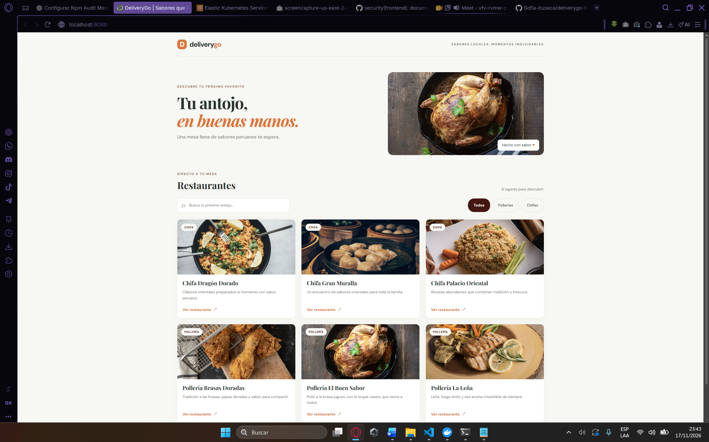

# DeliveryGo

> Aplicación de delivery con una interfaz web y dos servicios REST independientes.

## Índice

- [Resumen](#resumen)
- [Arquitectura y tecnologías](#arquitectura-y-tecnologías)
- [Ejecución local](#ejecución-local)
- [Desarrollo](#desarrollo)
- [Documentación](#documentación)
- [Evidencias del despliegue de DeliveryGo en AWS EKS](#evidencias-del-despliegue-de-deliverygo-en-aws-eks)

## Resumen

DeliveryGo permite consultar un catálogo de restaurantes, filtrar por nombre o categoría y ver los platos asociados a cada restaurante. El frontend consume por separado el servicio de Restaurantes y el servicio de Menús; ambos comparten UUID estables para relacionar los datos.

## Arquitectura y tecnologías

| Componente | Tecnologías | Responsabilidad |
| --- | --- | --- |
| Frontend | React, Vite, React Router, Nginx | Catálogo, búsqueda, filtros y detalle de restaurante |
| Restaurantes | ASP.NET Core 10, EF Core, PostgreSQL | Catálogo persistido de restaurantes |
| Menús | FastAPI, PyMongo, MongoDB | Menús y platos asociados a restaurantes |

Los servicios y sus bases de datos mantienen límites independientes. En el entorno local Docker Compose, la interfaz se sirve en el puerto `8080`, las APIs en `8081` y `8082`, y las bases de datos solo son accesibles dentro de la red privada de Compose.

## Ejecución local

Desde la raíz del proyecto:

```powershell
docker compose -f docker-compose.local.yml up --build -d
```

Abre `http://localhost:8080`. La documentación interactiva de las APIs está en `http://localhost:8081/swagger` y `http://localhost:8082/docs`. Para detener los servicios sin borrar los volúmenes:

```powershell
docker compose -f docker-compose.local.yml down
```

## Desarrollo

En este repositorio:

```bash
cp .env.example .env
npm install
npm run dev
```

Vite inicia normalmente en `http://localhost:5173`. Configura `VITE_RESTAURANT_API_URL` y `VITE_MENU_API_URL` según el entorno. Para validar el frontend, ejecuta `npm test` y `npm run build`.

Las guías de desarrollo de los servicios están en [`deliverygo-restaurantes`](https://github.com/Sofia-Itusaca/deliverygo-restaurantes) y [`deliverygo-menus`](https://github.com/Sofia-Itusaca/deliverygo-menus). Los pipelines CI son independientes por repositorio. Los manifiestos y workflows describen una ruta de despliegue; su presencia por sí sola no confirma que un despliegue remoto se haya ejecutado.

## Documentación

- [Índice de especificaciones](docs/README.md)
- [Especificación de arquitectura](docs/SPEC-02-arquitectura.md)
- [Especificación de Kubernetes](docs/SPEC-11-kubernetes.md)
- [Especificación de AWS EKS](docs/SPEC-12-aws-eks.md)

## Evidencias del despliegue de DeliveryGo en AWS EKS

Este apartado reúne los archivos multimedia presentes en el repositorio `deliverygo-frontend`. Las capturas se describen según lo que muestran; no se infiere un despliegue completo de etapas para las que no hay una captura específica. Los cuatro MP4 se enlazan como archivos de GitHub, sin afirmar que su contenido se haya revisado.

### 1. Infraestructura de AWS

La captura de la consola de Amazon EKS muestra el clúster `deliverygo-eks` como activo en la región de Ohio (`us-east-2`). La imagen corresponde a una vista de configuración del clúster y no demuestra por sí sola el estado de todas sus cargas.


### 2. Repositorios de imágenes en Amazon ECR

La captura muestra tres repositorios privados de contenedores con los nombres `deliverygo-frontend`, `deliverygo-menus` y `deliverygo-restaurantes`.


### 3. Configuración del clúster Kubernetes

La vista de EKS incluye el nombre y estado del clúster, su versión de Kubernetes y datos de configuración. No se encontraron capturas adicionales de manifiestos aplicados o de configuración del namespace.
La captura de configuración se muestra en la sección [Infraestructura de AWS](#1-infraestructura-de-aws).

### 4. Despliegue de PostgreSQL y MongoDB

No hay una fotografía o captura específica de PostgreSQL, MongoDB, sus pods ni su estado de conexión en los recursos multimedia del repositorio.

### 5. Despliegue del microservicio Restaurantes

No hay una captura específica del Deployment o de los Pods de Restaurantes. La evidencia de health checks de la sección 9 incluye una consulta a su endpoint de disponibilidad.

### 6. Despliegue del microservicio Menús

La captura de terminal de la sección 9 muestra salida de `kubectl logs` para `deliverygo-menus`, incluido el mensaje de MongoDB listo y la inicialización de menús. No se encontró una captura separada del objeto Deployment.

### 7. Despliegue del frontend

Las capturas de la sección 10 muestran la interfaz y una vista de detalle con platos. Son evidencia visual de la aplicación, pero no identifican por sí mismas el entorno donde estaba ejecutándose.

### 8. Verificación de Pods, Deployments y Services

No se encontró una captura dedicada de listados de `Pods`, `Deployments` y `Services`. La captura de terminal de la sección 9 muestra comandos de logs y port-forward, sin un listado completo de esos recursos.

### 9. Health Checks y funcionamiento de los microservicios

La captura de terminal muestra una consulta al endpoint `/health/ready` de Restaurantes con respuesta `Healthy`, y consultas a `/health/ready` y `/health/live` de Menús con respuesta `ready` y respuestas HTTP `200` visibles en los logs.


### 10. Visualización de la aplicación

La primera captura muestra la página principal con el listado de restaurantes, búsqueda y filtros por categoría.



La segunda captura muestra el detalle de un restaurante, su menú y los platos disponibles.


### 11. Evidencia audiovisual del despliegue

Los archivos MP4 originales están publicados en este repositorio. Cada enlace abre el archivo correspondiente en GitHub.

| Video | Archivo publicado | Acceso |
| --- | --- | --- |
| Evidencia audiovisual 1 | `EVIDENCIA.mp4` | [Abrir MP4 en GitHub](https://github.com/Sofia-Itusaca/deliverygo-frontend/blob/main/EVIDENCIA.mp4) |
| Evidencia audiovisual 2 | `EVIDENCIA 2.mp4` | [Abrir MP4 en GitHub](https://github.com/Sofia-Itusaca/deliverygo-frontend/blob/main/EVIDENCIA%202.mp4) |
| Evidencia audiovisual 3 | `EVIDENCIA 3.mp4` | [Abrir MP4 en GitHub](https://github.com/Sofia-Itusaca/deliverygo-frontend/blob/main/EVIDENCIA%203.mp4) |
| Evidencia audiovisual 4 | `EVIDENCIA 4.mp4` | [Abrir MP4 en GitHub](https://github.com/Sofia-Itusaca/deliverygo-frontend/blob/main/EVIDENCIA%204.mp4) |

Los archivos no tienen miniaturas publicadas ni descripciones de contenido en sus nombres; por eso se conservan sus nombres originales y se enlazan directamente, sin asignarles una etapa concreta del despliegue.
